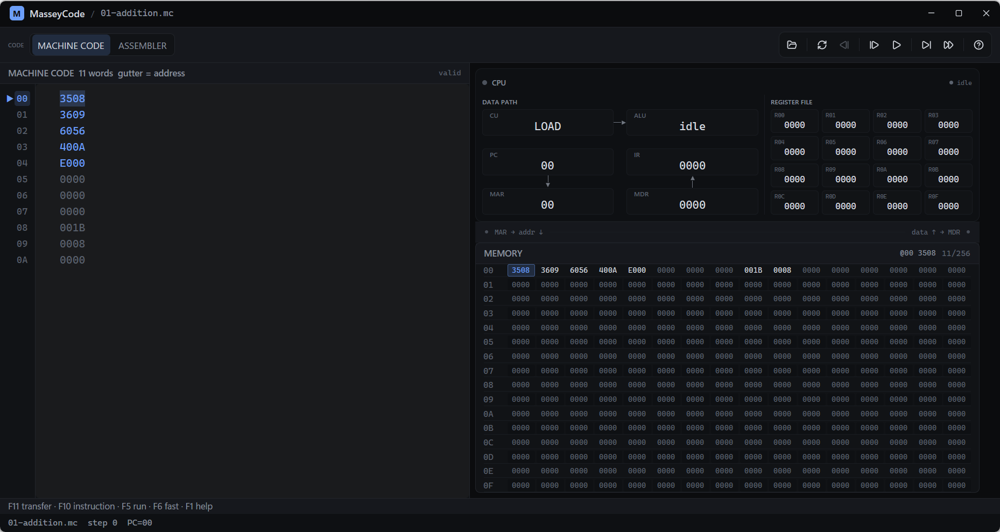
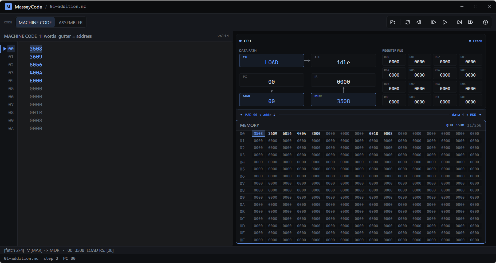
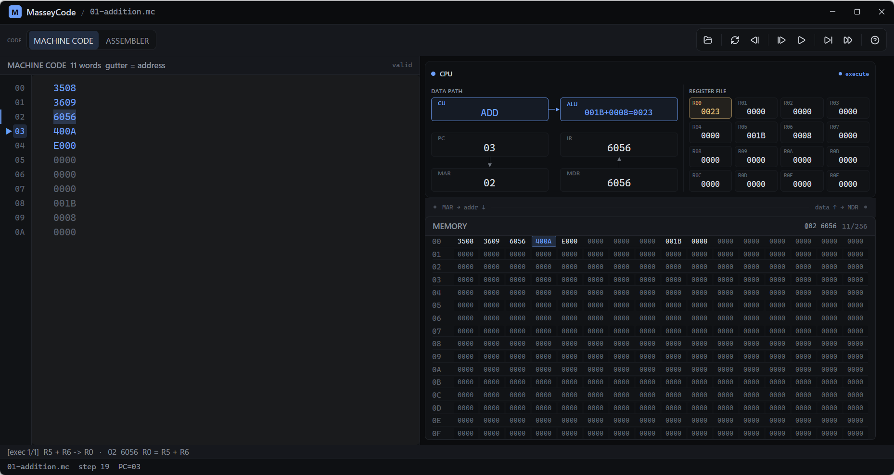
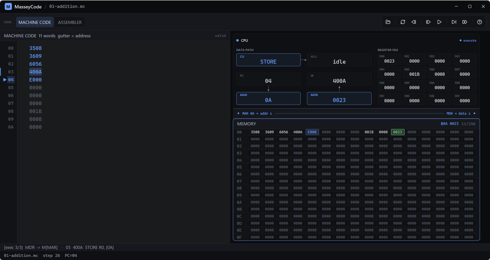
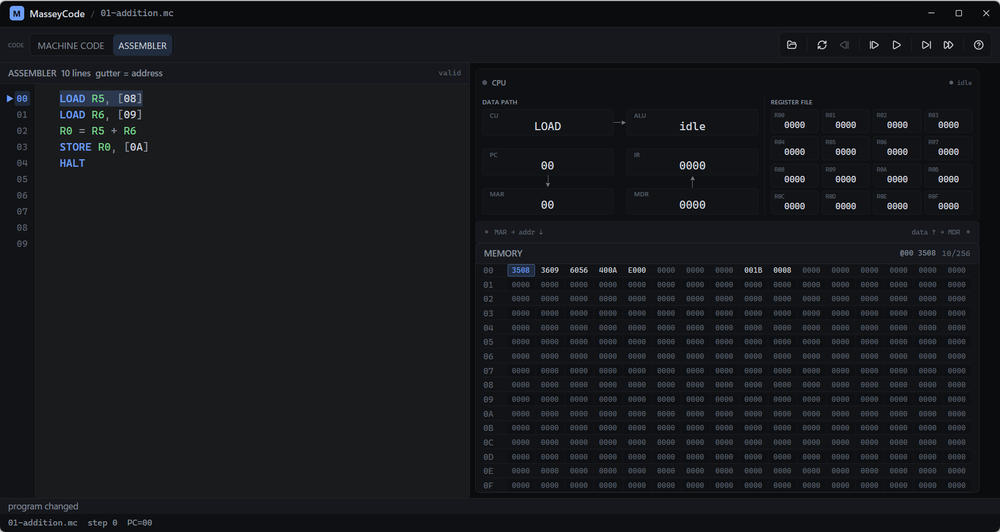
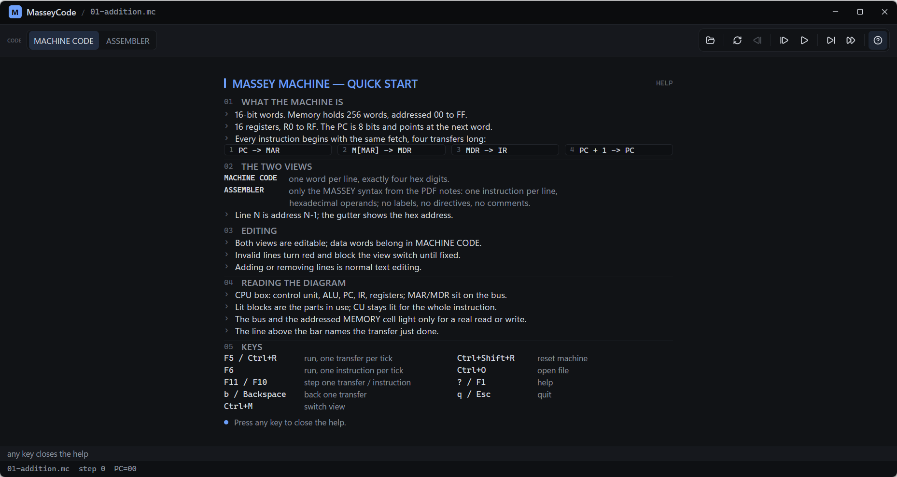

# Design

MasseyCode is a debugger for one machine cycle, made visible. Everything in the
window serves a single purpose: after one keypress, a student should be able to
say which parts of the machine moved, what crossed which bus, and what changed
as a result.

## Who it is for

* **Students** meeting the fetch–decode–execute cycle for the first time. They
  need to see a transfer happen, not a speed-run of a program.
* **Lecturers** demonstrating in front of a class, at whatever screen and window
  size the room has.
* **The curious** opening a `.mc` file to see what a machine word means.

That audience sets the rules: no hidden state, no mode that changes what a key
does, no animation that outruns the reading.

## Window anatomy

```
┌────────────────────────────────────────────────────────────────────────┐
│ ● MasseyCode / 01-addition.mc                          —  □  ×      │  title bar
├────────────────────────────────────────────────────────────────────────┤
│ CODE  [MACHINE CODE] [ASSEMBLER]             ▣  ↺  ◀  ▷  ⏵  ⏭  ?      │  toolbar
├───────────────────────────────┬────────────────────────────────────────┤
│ MACHINE CODE   11 words  valid│ CPU                          fetch     │
│ ┌───┬───────────────────────┐ │  DATA PATH            REGISTER FILE  │
│ │00 │ 3508                  │ │  ┌──────┬──────┐     ┌────┬────┬──┐ │
│ │01 │ 3609                  │ │  │ CU   │ ALU  │     │ R00│ R01│… │ │
│ ▶02 │ 6056                  │ │  ├──────┼──────┤     ├────┼────┼──┤ │
│ │03 │ 400A                  │ │  │ PC   │ IR   │     │ R04│ R05│… │ │
│ │04 │ E000                  │ │  ├──────┼──────┤     └────┴────┴──┘ │
│ │…  │                       │ │  │ MAR  │ MDR  │                      │
│ └───┴───────────────────────┘ │  └──────┴──────┘                      │
│                               ├────────────────────────────────────────┤
│                               │ ● MAR 02 → addr ↓      data ↑ → MDR    │  bus row
│                               ├────────────────────────────────────────┤
│                               │ MEMORY                    @02 6056 11/256│
│                               │ 00 3508 3609 6056 400A E000 …          │  16 x 16
│                               │ 01 0000 …                              │
│                               └────────────────────────────────────────┘
├────────────────────────────────────────────────────────────────────────┤
│ [fetch 2/4] M[MAR] -> MDR · 02 6056 LOAD R5, [08]                      │  footer
│ F11 transfer · F10 instruction · F5 run · F6 fast · F1 help            │
│ 01-addition.mc   step 6   PC=02                                        │
└────────────────────────────────────────────────────────────────────────┘
```

| Band | Height (logical px) | Contents |
| --- | --- | --- |
| title bar | 34 | workspace mark, file name, window controls |
| toolbar | 44 | view switch, open, reset, back, the two step buttons, the two run buttons, help |
| workspace | fills | source pane (left), machine (right) |
| footer | 42 | last transfer, key hints, step/PC/state |

The split is fixed: the source pane is on the left and the machine on the right,
at every window size. The vertical divider is a 1 px hairline, not a drag
handle; the split ratio is computed from the window width, not stored.

## Interaction model

The debugger is **always transfer-granular**. One keypress advances one
register transfer, so the diagram and the footer always describe the same
event. Instruction-level stepping exists *on top* of that, as a second pair of
buttons: it runs the remaining transfers of the current instruction in one go.
There is no mode switch, because a mode switch would make the same button mean
two things.

| Action | Control |
| --- | --- |
| one transfer | `F11`, ▶ button |
| one instruction | `F10`, ⏭ button |
| run transfer by transfer | `F5` / `Ctrl+R`, ▷ button (becomes pause) |
| run instruction by instruction | `F6`, ⏭-run button (becomes pause) |
| back one transfer | `b` / `Backspace`, ◀ button |
| reset machine | `Ctrl+Shift+R`, ↺ button |
| open a file | `Ctrl+O`, ▣ button |
| switch Machine Code / Assembler | `Ctrl+M`, the segmented control |
| memory scroll | `j k h l` or arrow keys; `Home` / `End` |
| help | `F1` or `?` |
| quit | `q` / `Esc` |

On macOS the `Ctrl` shortcuts also accept `Cmd`.

While running, the run button turns into pause and the CPU dot pulses; pressing
any other key pauses first and then performs the action, so a keypress never
gets lost in a running machine.

The source pane is editable in both views. The Assembler view validates every
line as it is typed: invalid lines turn red, the pane header counts the errors,
and the view switch is blocked until the program is valid again. That keeps the
machine code and assembler views from ever disagreeing.

## Visual grammar

Colour is reserved for meaning. There are five roles and nothing else:

| Colour | Value | Meaning |
| --- | --- | --- |
| accent (blue) | `#6C9EF8` | the current instruction, PC, a real bus transfer, the addressed memory word |
| active (yellow) | `#E5C07B` | the register this transfer acts on |
| changed (green) | `#7BD88F` | a value changed by the last transfer |
| danger (red) | `#E06C75` | a machine fault, an invalid source line |
| text / muted / faint | greys | everything that is just information |

Black and greys carry no meaning beyond hierarchy.

What lights up is decided by the machine, not by the wording of a transfer
line. The diagram reads the `MicroOp` the VM produced and marks exactly the
parts that took part:

| Event | What is lit |
| --- | --- |
| any transfer of the current instruction | the `CU` tile, for the whole instruction, fetch included |
| `PC -> MAR` | `PC`, `MAR` |
| `M[MAR] -> MDR` | `MAR`, `MDR`, the bus row, the addressed memory cell |
| `MDR -> IR` | `MDR`, `IR` |
| `PC + 1 -> PC` | `PC` (with a `+1` chip) |
| `MDR -> Rx` / `Rx -> MDR` | `MDR`, `Rx` |
| ALU result written to `Rx` | `ALU` (with the equation), `Rx` |
| a taken jump | `PC`, the jumped-to line |
| a jump that is **not** taken | nothing on `PC`, because `PC` did not move |
| `STORE` through memory | the bus row labelled `MDR -> data`, the target memory cell |
| halted / faulted | no highlight at all |

The bus row is the only place where direction is read out loud: `MAR 02 -> addr`
on the left, `data ↑ -> MDR` for a read and `MDR -> data ↓` for a write on the
right. It is lit only when the transfer really uses the bus, which is why a
`LOAD Rx, Ry` does not make it flash.

The register file obeys one rule: **one cell, one colour.** A register that the
transfer touches is entirely yellow — border, label and value. A register whose
value changed without being the target flashes green for about a quarter of a
second. Mixing the two on one cell was tried and reads as a rendering bug, so it
is not allowed.

The PC has its own marker: a filled `▶` in the address gutter and a blue row in
the source pane, plus an arrow on the `PC` tile while the fetch is on. No dot or
badge is added to the register file; the PC arrow and the row already say it.

## Layout and responsiveness

The window is usable from **900×600** up and never clips: at the minimum size
the same structure remains, with smaller type and the memory grid scrolled
horizontally instead of cut off.

* **Default window**: 1180×760, centred.
* **Minimum window**: 900×600.
* **Wide / high-DPI**: everything scales; the machine half keeps a maximum
  content width so the datapath does not turn into a sparse island on a 4K
  monitor.

The machine half is built from three fixed-height decisions and two flexible
ones:

| Region | Rule |
| --- | --- |
| CPU card | 31% of the workspace height, clamped to 190–280 px |
| bus row | 26 px |
| memory | the rest, at least 120 px |
| memory row height | available height / 16, clamped to 9–44 px |
| memory cell width | available width / columns, clamped to 16–64 px |
| memory columns | 16, else 12, else 8, else 6 — whichever keeps cells ≥ 18 px |
| datapath row height | CPU card body / 3, with 16 px gaps |
| register cell height | register body / 4, with 4 px gaps |

Inside a datapath tile and inside a register cell the label and the value are
sized from the space the tile actually got, in five steps, and always with
padding above and below. A short window therefore gets smaller type with the
same breathing room, never type pressed against a border.

All gaps are the same 16 px: between datapath blocks, horizontally and
vertically, with or without a connector. The connectors are 1 px shafts with a
7 px head that stops at the destination border; they do not change the gap.

## Typography and spacing

| Role | Font | Size |
| --- | --- | --- |
| source code, machine values | mono: Cascadia Mono / Menlo / DejaVu Sans Mono | 12.5–15 px, by window width |
| labels and headings | sans: Segoe UI Variable Text / Helvetica Neue / DejaVu Sans | 8–13 px |
| hex values in tiles | mono | 8.5–16 px, by tile height |

Spacing is a small scale — 4, 6, 8, 16 — and the number of distinct values in
the window is deliberately small. Radii are 4 px for tiles and cells, 8 px for
cards. There are no shadows.

Animation is limited to two things: a 240–260 ms border fade when a value
changes, and a 700 ms pulse on the CPU dot while running. Nothing moves, nothing
slides, no transition delays a keypress.

## Help pane

`F1` replaces the source pane with a one-page handout, laid out at the same
type scale as the rest of the window:

1. **What the machine is** — word size, memory, registers, PC, and the four
   fetch transfers drawn as four chips.
2. **The two views** — machine code and assembler, and that line *n* is address
   *n − 1*.
3. **Editing** — both views are editable, invalid lines turn red, view switch
   is blocked until valid.
4. **Reading the diagram** — what a lit tile means, why the CU stays lit, why
   the bus lights, why a not-taken jump does not move the PC arrow.
5. **Keys** — the table above.

Any key closes it and returns to the program.

## Deliberate boundaries

These are design decisions, not omissions to fix:

* One stepping model. No micro/instruction toggle.
* No breakpoints and no goto-address: both duplicate what stepping already
  offers, and both add state the diagram would have to explain.
* No labels, directives or comments in the Assembler view. The view is the
  notation of the course notes, so what is typed there is exactly what the
  notes show; example listings with labels live in `examples/*.asm`.
* No theme switcher and no settings window. One dark, high-contrast look that
  works in a lecture theatre.
* No animation of data moving along a wire. The lit endpoints carry the
  information; a moving block would carry it slower.

## Screenshots

| | |
| --- | --- |
|  |  |
|  |  |
|  |  |

The minimum window is `screenshots/minimum-window.png`.
